<div align="center">

# ARTEX

AI autonomous penetration testing system (Go backend + Next.js frontend)

</div>

> [!NOTE]
> **English translation.** This fork is an English translation of ARTEX v0.3.15 by [Autumn-27](https://github.com/Autumn-27), covering the UI, agent prompts, skills, code comments and docs (translated 8 October 2026). The original repository is no longer public, so this fork stands on its own: releases, the `ghcr.io/logan-han/artex` Docker image and the in-app updater all come from this repository, and the `norma` SDK is vendored in [`third_party/norma`](third_party/norma). Until a release is published here, the Docker install builds the image from source.

---

## Screenshots

| Dashboard (overview / token usage / activity feed) | Task list |
| :---: | :---: |
| 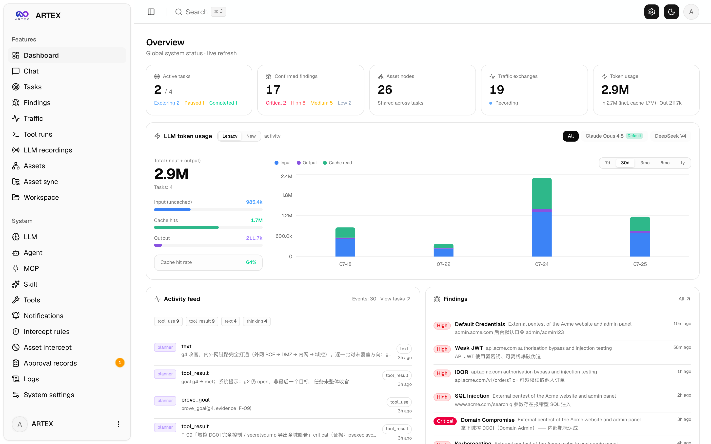 | 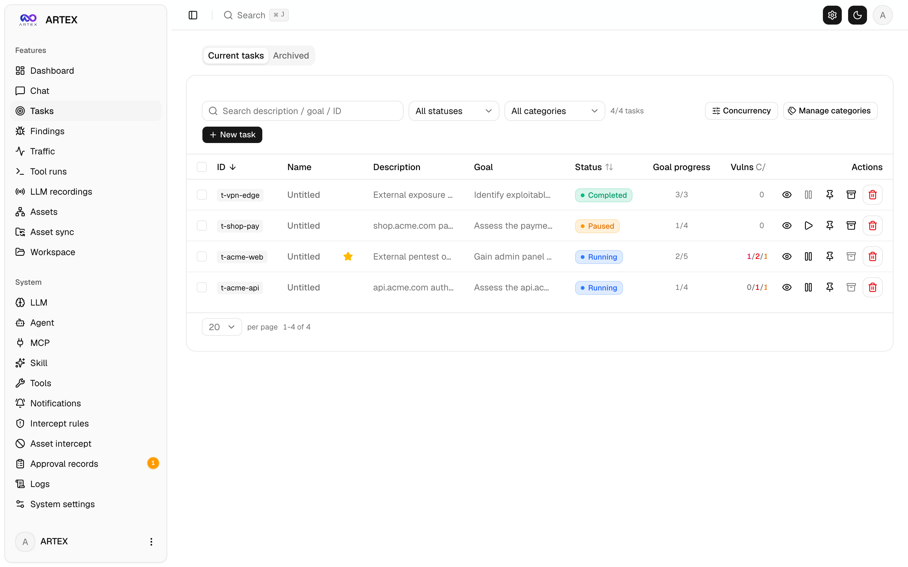 |

| Task execution (sessions / tool calls) | Exploration chain |
| :---: | :---: |
| 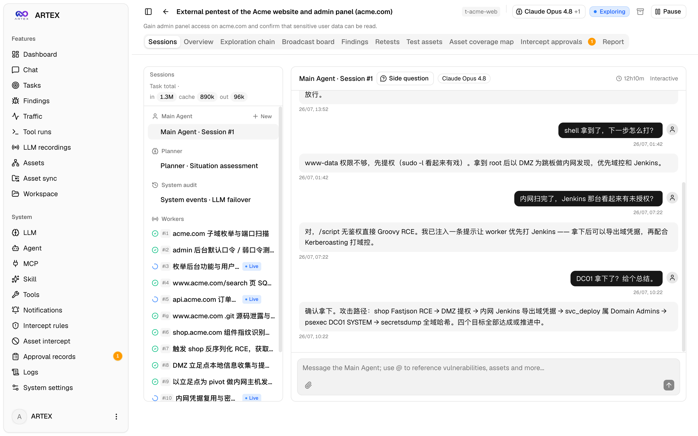 | 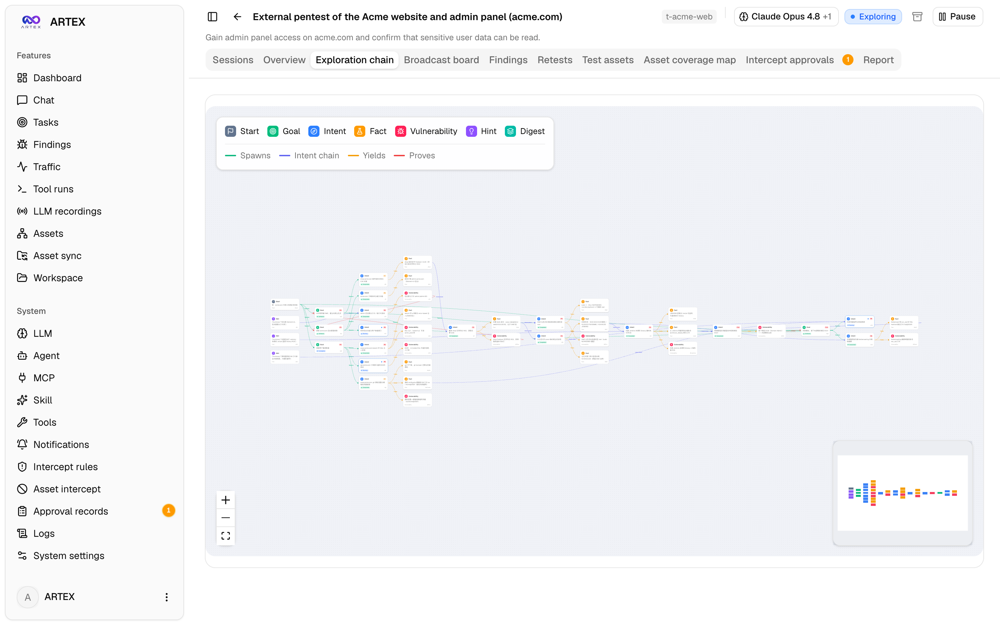 |

| Findings | Assets |
| :---: | :---: |
| 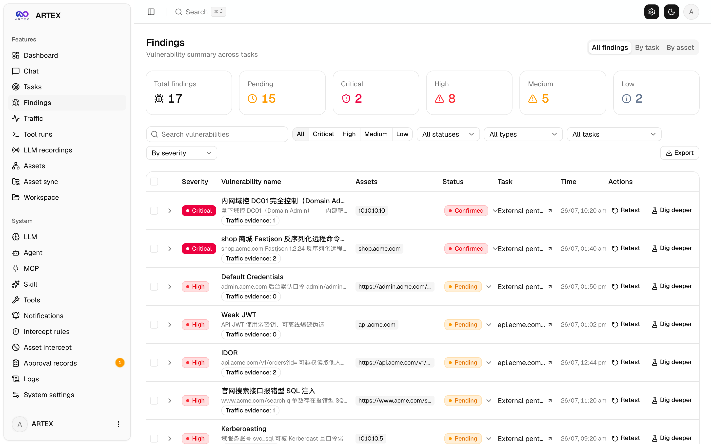 | 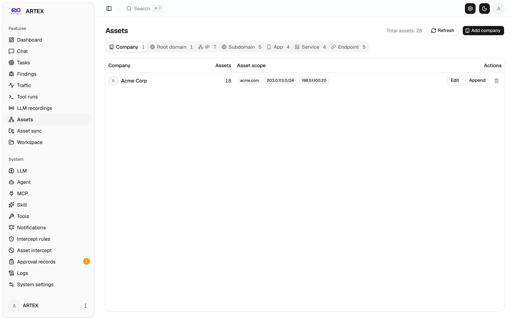 |

| Asset coverage map (force-directed layout · tested assets highlighted · collapsible nodes) |
| :---: |
| 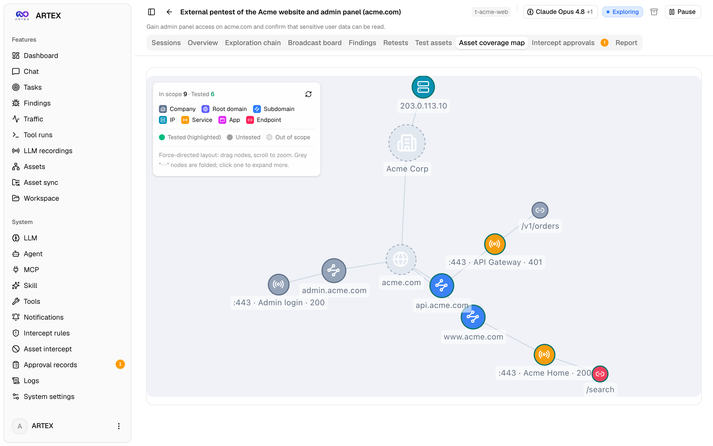 |

| Traffic recording | Human-in-the-loop chat |
| :---: | :---: |
| 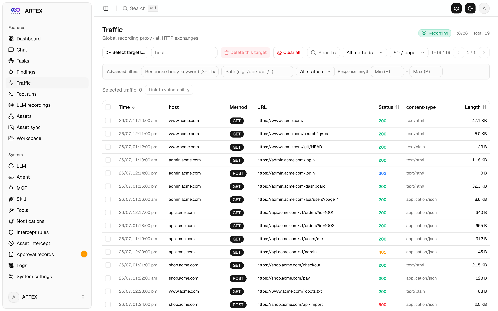 | 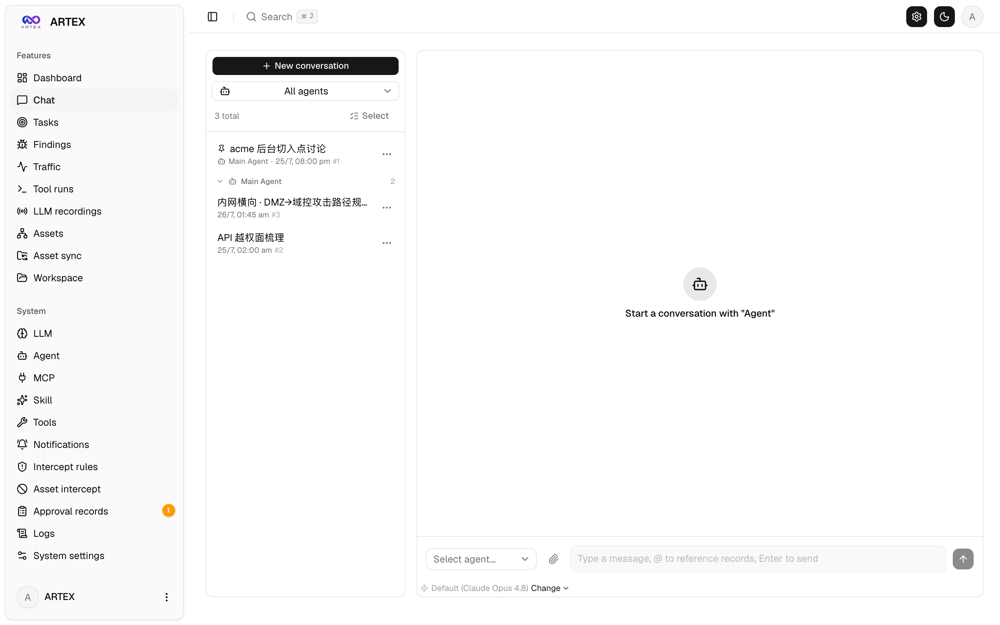 |

| Agent management | LLM settings |
| :---: | :---: |
| 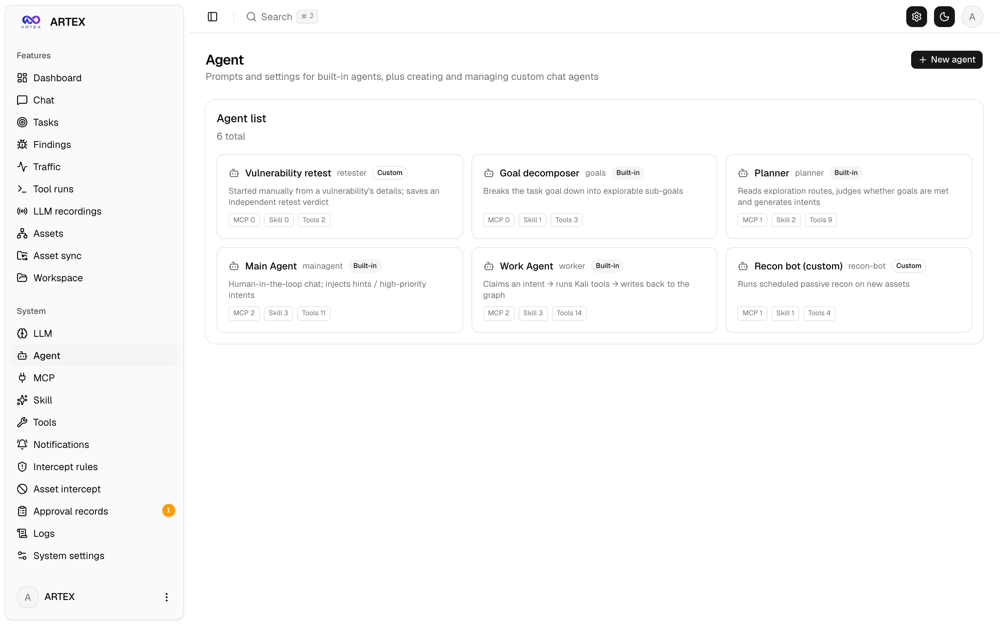 | 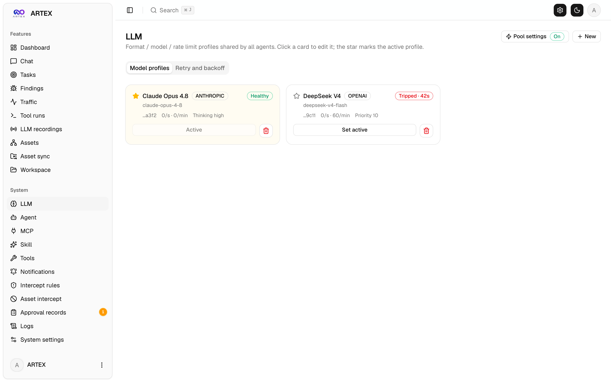 |

| Intercept approvals | Backend logs |
| :---: | :---: |
| 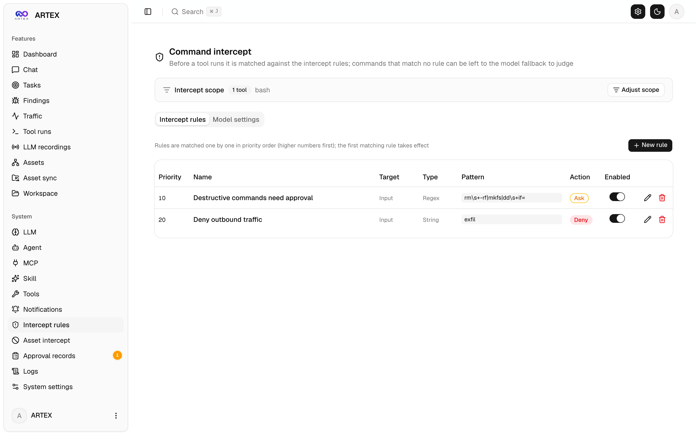 | 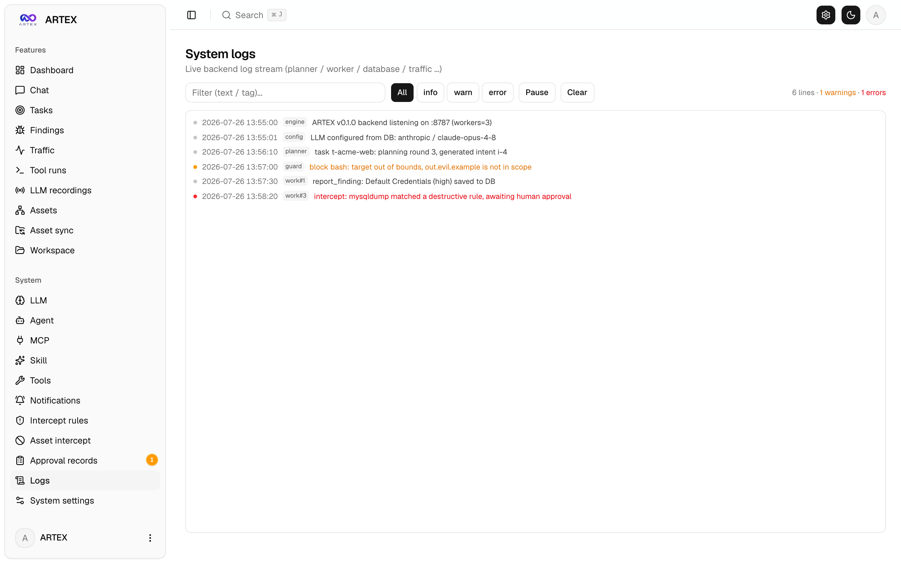 |


---

## Approval record details

The global "Approval records" page, the in-task "Intercept approvals" view and approval cards in chat can all be expanded to show details. The layout follows
[AegisHook's approval detail component](https://github.com/RuoJi6/AegisHook/blob/main/web/src/components/CallDetail.vue), built with ARTEX's own components and theme.


## Asset sync (ScopeSentry)

Asset data can be synced straight from [ScopeSentry](https://github.com/Autumn-27/ScopeSentry), so you don't have to collect it twice:

- On the "**Asset sync**" page, enter the ScopeSentry address and API key to connect the data source;
- Pick the targets and asset types to sync by **project** or **task** (domains / subdomains / IPs / ports / sites / endpoints...);
- Import in one click: assets are merged by company asset scope and go straight into ARTEX's asset graph for the agents to explore.

---

## Installation

> Requires a **PostgreSQL** database. Exploration needs an **LLM** (`ANTHROPIC_API_KEY` or `OPENAI_API_KEY`, or configure it in the UI).

### Option 1: one-click install script (recommended)

```bash
git clone https://github.com/logan-han/ARTEX.git
cd ARTEX
./install.sh
```

The script detects Docker (installing it if needed), then asks you to choose **① Everything in Docker** or **② Build and run locally**:

- **① Everything in Docker**: enter a Postgres password (press Enter for a random one) → `.env` is written for you → `docker compose up -d`.
- **② Run locally**: choose a database (connect to an existing one / start one in Docker) → `config.json` is generated → `go` builds a single binary with the frontend embedded → it starts.

Once installed, open **http://localhost:8787** (on your first visit, `/setup` asks you to set the admin password).

### Option 2: Docker Compose (manual)

```bash
git clone https://github.com/logan-han/ARTEX.git
cd ARTEX
cp .env.example .env          # set POSTGRES_PASSWORD, optionally ANTHROPIC_API_KEY
docker compose up -d          # pulls (or builds) the artex image + postgres
# → http://localhost:8787
```

If `ghcr.io/logan-han/artex` hasn't been published yet, Compose builds the image from your checkout with the `Dockerfile` (a few minutes the first time). Use `docker compose up -d --build` to always build from your checkout.

The image ships common tools (ripgrep/curl/vim/npm/nmap...); `./skills` and `./data` persist as bind mounts.

For remote MCP servers, choose `http` (Streamable HTTP) or `sse` (legacy SSE) in system settings.
Legacy SSE servers usually open the event stream with `GET /sse` and then accept JSON-RPC requests at the
`/message?sessionId=...` URL the server returns. Set the URL to `/sse` and enter the header as
`Authorization=Bearer <token>`.

### Option 3: download a prebuilt binary (Releases)

Download the zip for your platform from [Releases](https://github.com/logan-han/ARTEX/releases). It unpacks to `artex` + `start.sh` (`start.bat` on Windows) + `skills/` + `config.example.json`:

```bash
cp config.example.json config.json   # fill in the database connection
./start.sh                           # → http://localhost:8787
```

> Start it with `start.sh` / `start.bat` rather than running `./artex` directly. It is a supervisor script: when the program exits, it uses the exit code to decide whether to start it again, and **the [one-click update](#option-1-one-click-update-in-the-ui-recommended) in the UI relies on it to swap in the new binary**. If you run `./artex` directly, nothing restarts it after an update.
> To keep it running in the background: `nohup ./start.sh >artex.log 2>&1 &`.

### Option 4: build a single binary from source

```bash
# 1) Static export of the frontend
cd web && npm ci && npm run build:static && cd ..
# 2) Copy it into the embed directory
rm -rf server/webui/dist && cp -r web/out server/webui/dist
# 3) Build (-tags embedui is what embeds the frontend)
CGO_ENABLED=0 go build -tags embedui -o artex ./cmd/artex
./start.sh
```

### Option 5: build cross-platform release archives

`build.sh` builds and embeds the frontend first, strips debug info with the Go linker, and packs the release files into zips. Release mode builds zips for Linux amd64/arm64, macOS amd64/arm64 and Windows amd64 by default:

```bash
./build.sh --release
# Output: dist/artex-0.3.3-*.zip
```

UPX self-extracting binaries can be incompatible with some Linux kernels, virtualised environments or security policies, so UPX is off by default. Set custom targets with `ARTEX_TARGETS`; once you've confirmed the target environment is compatible, pass `--upx` explicitly to shrink the binary further:

```bash
ARTEX_TARGETS=linux/amd64,windows/amd64 ./build.sh --release
./build.sh --target linux/amd64 --upx
```

Pushing a `v*` tag runs `.github/workflows/release.yml`, which publishes these zips plus `SHA256SUMS` to this repository's Releases (where the in-app updater looks) and pushes the multi-arch image to `ghcr.io/logan-han/artex`.

---

## Updating

> Upgrading replaces the program and leaves your data alone: the Postgres volume `pgdata`, `./data` (jwt.key / SQLite etc.) and `./skills` are all kept. **No manual database migration is needed**: `artex` re-runs `schema.sql` idempotently on every start (including `ADD COLUMN` / `CREATE INDEX IF NOT EXISTS`), so a restart is a migration. Backing up `./data` and the database before upgrading is still recommended.

### Option 1: one-click update in the UI (recommended)

On the **System settings** page (sidebar "System settings" → `/system/settings`), the **Version and updates** card lets you check for and install new versions without logging in to the server.

Clicking "Update" downloads the release package for the current platform → verifies it against the release's `SHA256SUMS` → smoke-tests the new binary with `-h` → stages it as `artex.new` → exits, and `start.sh` / `start.bat` restarts the program to finish the swap. The page waits for the new version to come up and then refreshes.

- **A failed update never leaves a broken program behind**: if verification or the smoke test fails, the staged file is discarded and the current version keeps running. If the new version fails to start 3 times in a row after the swap, it rolls back to `artex.old` automatically (the failed binary is kept as `artex.failed` for troubleshooting).
- **You can roll back at any time**: the previous version is kept as `artex.old`, and the card has a "Roll back to previous version" button. Note that the database schema is not rolled back.
- **Updating interrupts running tasks**: an update is a restart, so do it when the system is idle.
- **Development builds can't update**: updates are disabled when the version is `dev` or a `git describe` string with a suffix, so a release never overwrites a binary you're debugging locally.
- **In Docker, only the program is replaced, not the image**: toolchains in the image such as playwright / nmap are not upgraded, and recreating the container with `docker compose up -d` reverts to the version baked into the image. To upgrade the image as well, use `docker compose pull artex && docker compose up -d artex`.
- If you need a proxy to reach GitHub, set the **global proxy** on the same page and updates will use it. Updates only download from GitHub domains and always use HTTPS.

### Option 2: one-click update script

```bash
cd ARTEX
./update.sh
```

The script optionally runs `git pull` to fetch the latest code, then asks you to choose **① Docker update** or **② Local build update** (matching `install.sh`):

- **① Docker**: optionally pick a target image tag (press Enter to keep `ARTEX_TAG` from `.env`, default `latest`) → `docker compose pull` (or `docker compose build` from your checkout when no image is published) → `docker compose up -d` (restarting on the new image migrates automatically).
- **② Local**: rebuilds the static frontend → recompiles `./artex` (restart the process afterwards to apply it).

### Option 3: Docker Compose (manual)

```bash
cd ARTEX
git pull                       # update compose / scripts (optional)
# Pin a version: set ARTEX_TAG=v0.2.0 in .env; otherwise latest is used
docker compose pull artex      # or, with no published image: docker compose build artex
docker compose up -d artex     # restart on the new image → schema migrates automatically
docker image prune -f          # clean up old images (optional)
```

### Option 4: prebuilt binaries (Releases)

Download the new zip from [Releases](https://github.com/logan-han/ARTEX/releases), stop the old process, overwrite `artex` and `skills/` (keep your `config.json` and `data/`), then restart:

```bash
cp -r <unzipped-dir>/skills ./ && cp <unzipped-dir>/artex ./
./start.sh
```

### Option 5: build from source

```bash
git pull
cd web && npm ci && npm run build:static && cd ..
rm -rf server/webui/dist && cp -r web/out server/webui/dist
CGO_ENABLED=0 go build -tags embedui -o artex ./cmd/artex
# restart ./start.sh
```

---

## Configuration

**Database** (`config.json`, or override it with the `ARTEX_PG_DSN` environment variable):

```json
{
  "database": {
    "host": "127.0.0.1", "port": 5432,
    "user": "artex", "password": "yourpass",
    "dbname": "artex", "sslmode": "disable"
  }
}
```

**LLM**: `export ANTHROPIC_API_KEY=sk-...` (or `OPENAI_API_KEY`), or fill it in on the "LLM" page in the UI.
Optional: `ARTEX_LLM_PROVIDER` / `ARTEX_LLM_MODEL` / `ARTEX_LLM_BASE_URL` / `ARTEX_LLM_PROXY`.

**Concurrency**: the number of work agents per task is set in "System settings" (default 3).

**Common flags**: `./start.sh -addr :8787 -proxy :8788` (`-addr` for the frontend + API, `-proxy` for the traffic recording proxy). The start script passes arguments through to `artex` unchanged.

### Behind a reverse proxy (HTTPS / only port 443 open)

The frontend and the API/SSE are all served from the same backend port (`:8787` by default), and the live activity feed uses the **same origin** by default, so **you don't need to set `NEXT_PUBLIC_SSE_BASE`**: expose only 443 publicly and keep 8787 on the internal network.

SSE is a long-lived connection with continuous pushes, so the reverse proxy **must disable buffering**. Otherwise the browser connects but never receives events (the activity feed just keeps spinning). Nginx example:

```nginx
server {
    listen 443 ssl;
    server_name your.domain.com;
    # ssl_certificate / ssl_certificate_key ...

    location / {
        proxy_pass http://127.0.0.1:8787;
        proxy_set_header Host $host;
        proxy_set_header X-Forwarded-Proto $scheme;

        # Key SSE settings: no buffering, long timeout, HTTP/1.1
        proxy_buffering off;
        proxy_cache off;
        proxy_read_timeout 3600s;
        proxy_http_version 1.1;
        proxy_set_header Connection "";
    }
}
```

> Only set `NEXT_PUBLIC_SSE_BASE` at **build time** when SSE has to use a different origin from the page (such as a separate subdomain). The variable is baked into the static bundle by `next build`, so setting it at container runtime has no effect.

---


## Development

### Manual vulnerability retests

The "Retest" tab in task details lets you page through the task's vulnerabilities, review past verdicts and evidence, and start a retest manually. After it starts you stay on the current tab, which shows a spinner and "Retesting"; once a fix is confirmed, the vulnerability status is updated to match.

Click "Retest" in a row's actions in the vulnerability list, or "Start retest" in the "Vulnerability retest" section of the vulnerability details, then optionally fill in the fixed version, test conditions or limits. The system creates a separate retest agent session and keeps you on the current page. The flat list, grouped-by-task and asset views all offer this entry point. While a retest runs, it shows a spinner and "Retesting"; click it to open the matching session, and it changes back to "Retest" when done. A retest doesn't need the original scan task to be restarted. Verdicts are "Still reproducible", "Fixed" or "Inconclusive", and each verdict, its evidence and the session link are saved in the vulnerability details.

On first start, the new backend seeds an editable "Vulnerability retest" (`retester`) agent; configure its prompt, LLM, run budget and tools under Agent management. It uses the LLM bound to it, or the globally active configuration if none is bound. When a retest session completes successfully with a "Fixed" verdict, the vulnerability's triage status is set to "Fixed" automatically; running, failed or stopped sessions and other verdicts leave the status unchanged. The original evidence and report are always kept. You can also pick "Fixed" manually from the status dropdown. If a vulnerability is already being retested, the existing session is reused; after a stop, failure or service restart you can start a new one.

In this version, retest history is viewed through the vulnerability details and sessions. It isn't yet included in vulnerability report exports or task archive packages, and it isn't linked to traffic captures automatically. Demo mode only generates clearly labelled simulated records and never sends requests to real targets.

### Running and testing locally

```bash
./dev.sh    # backend (:8787) + traffic proxy (:8788) + frontend next dev (:5173) → http://localhost:5173
```

- Backend: `go run ./cmd/artex` (without `-tags embedui` the frontend isn't embedded)
- Frontend: `cd web && npm run dev` (`/api` is proxied to the backend, with hot reload)
- Tests: `go test ./...`
- Mock preview (no backend): `cd web && NEXT_PUBLIC_MOCK=1 npm run dev`

---

## Architecture

ARTEX is an **autonomous penetration testing system driven by multiple LLM agents**: a monolithic Go backend (with the Next.js frontend embedded) + PostgreSQL, with agent capabilities provided by the [`norma`](https://github.com/Autumn-27/norma) SDK (vendored in [`third_party/norma`](third_party/norma); `agentcore` / `tool` / `permission` / `harness` / `memory` / `transcript`). At its core is a **dual-graph architecture**, plus two autonomy mechanisms built around it: **trace-level information exchange between workers**, and a **todo list the planner shares across rounds to keep attack chains stable**.

### Layers

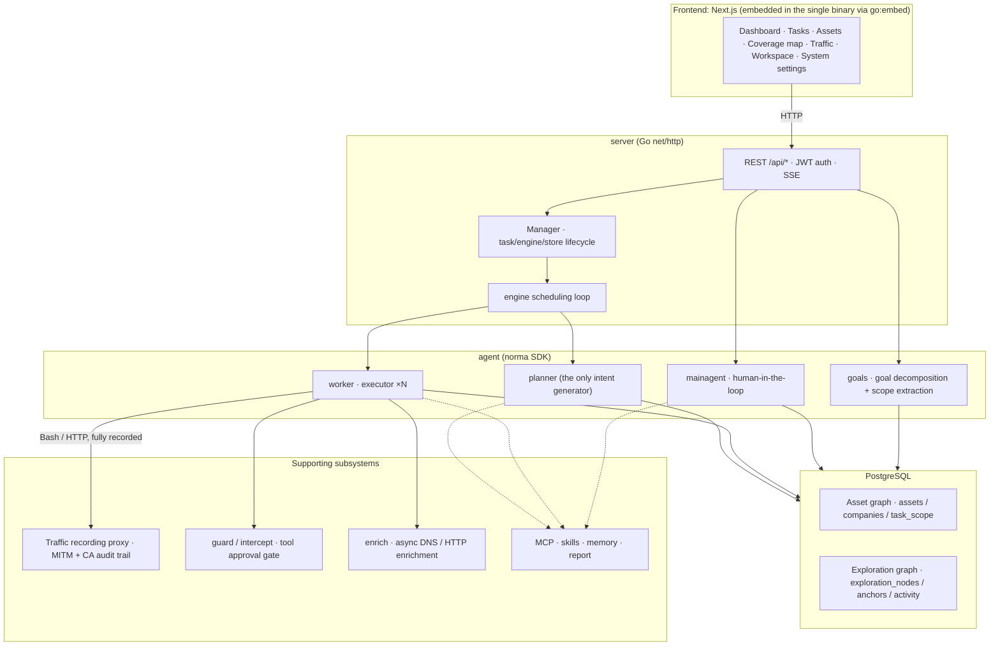

| Layer | Responsibility |
| --- | --- |
| **Frontend** | Next.js static export, embedded into the single binary with `go:embed`; visualises tasks, assets, exploration chains and the coverage map, plus human-in-the-loop chat |
| **server** | `net/http` routing + JWT auth + SSE; `Manager` owns the lifecycle of tasks, engines and the DB store |
| **engine** | One `plannerLoop` + N worker goroutines per task; intent claiming, timeout/pause/drain |
| **agent** | goals / planner / worker / mainagent; `ToolSet` exposes both graphs to the LLM as tools |
| **db** | Postgres storage for both graphs (pgx); the schema ships via `go:embed` and its tables are created idempotently on every start |
| **Supporting** | Recording MITM proxy, approval gate, async enrichment, MCP/skills/memory/reports |

### Dual graphs: exploration graph + asset graph

The system splits "**what the target is**" and "**how far testing has got**" into two independent graphs linked by anchors:

- **Asset graph (global, shared)**: one source of truth for assets across all tasks. Nodes are `root_domain / subdomain / ip / service / app / endpoint` and belong to companies. Parent-child relations (domain → subdomain → service → endpoint) and dedup keys are all computed by code; agents only submit raw information.
- **Exploration graph (one per task)**: the "thinking and progress" of a single task. Nodes are `goal / intent / fact / finding (vulnerability) / hint`, connected into **lineage chains** by edges such as `spawns / derived_from / yields / proves`, answering "which direction was derived from which facts, and what did it produce".
- **Anchors link the two graphs**: `exploration_anchors(node_id, asset_id)` anchors intents, facts and vulnerabilities to specific assets. From an exploration direction you can see which assets it hit, and from an asset you can look up which intents tested it in this task and which facts they produced. This also powers **asset test coverage** and the **asset coverage map** (in-scope assets, with tested ones highlighted).

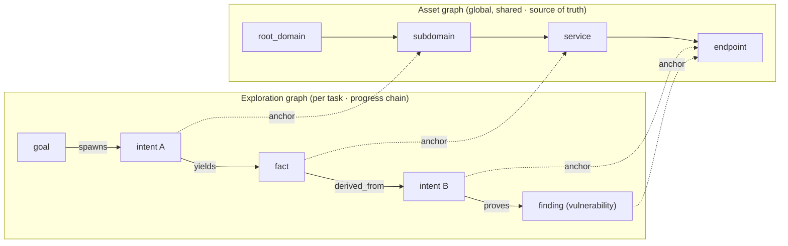

> Division of labour: the **planner** reads the state of the exploration graph, judges the goal, and only dispatches **intents** to the frontier when there is a new, uncovered direction. A **worker** claims **one intent**, executes it with real tools, writes new assets, facts and vulnerabilities back to both graphs, then stops. The asset graph holds shared facts; the exploration graph is each task's progress chain.

### Engine and intent lifecycle (the exploration loop)

The engine is an **event-driven** loop: any graph change wakes the planner, the planner dispatches intents, workers claim and execute them and write results back, and each write-back triggers the next round, until the goal is proven (`prove_goal`).

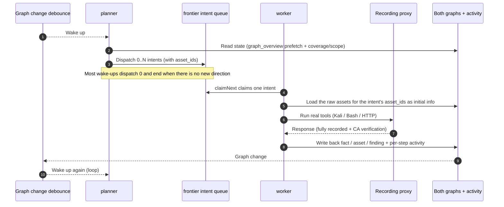

### Trace-level information exchange between workers

In a deep exploration, many valuable observations (an error message, part of a response, a hidden parameter) show up in one worker's **execution trace** without ever being written up as a formal fact. To avoid duplicated effort and let workers along a chain build on each other's work, workers can **search the traces of other work**:

- `search_all_worker_traces(q)`: keyword search across **the execution traces of other work in this task** (steps from the worker's own intent are excluded automatically); hits carry an `intent_id`;
- `list_worker_traces` / `get_worker_trace(intent_id, step_ids=[…])`: first see which work has run, then fetch the full content of specific steps of one work item to exchange details.

So even when the exploration graph has no matching fact yet, later workers can reuse observations from other workers' traces: **information flows between workers at the granularity of execution traces**, while the boundaries stay the same (each worker still only works on the intent it claimed).

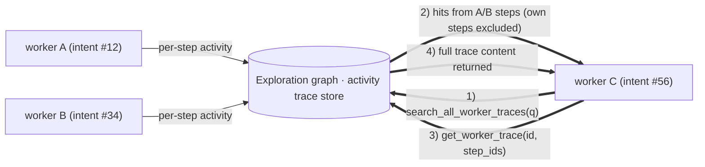

### Planner todo list shared across rounds → stable attack chains

Real attack chains are usually **multi-step sequences with dependencies** (for example: find an injection point → obtain credentials → move laterally → escalate privileges), and dispatching all of them in parallel at once just creates chaos. So the planner keeps a **planning todo list that persists per task and is shared across wake-ups**:

- The planner is event-driven: it wakes up whenever the graph changes, but **every wake-up is a brand-new session**. The shared todo list lets it **record a sequential exploit chain once** and then **dispatch intents step by step as dependencies are met** over later rounds, instead of laying out the whole chain up front in a single round;
- Each round only dispatches intents for next steps whose "prerequisite steps are done and the facts they depend on exist", and updates the list as things progress (marking steps already satisfied by facts as completed).

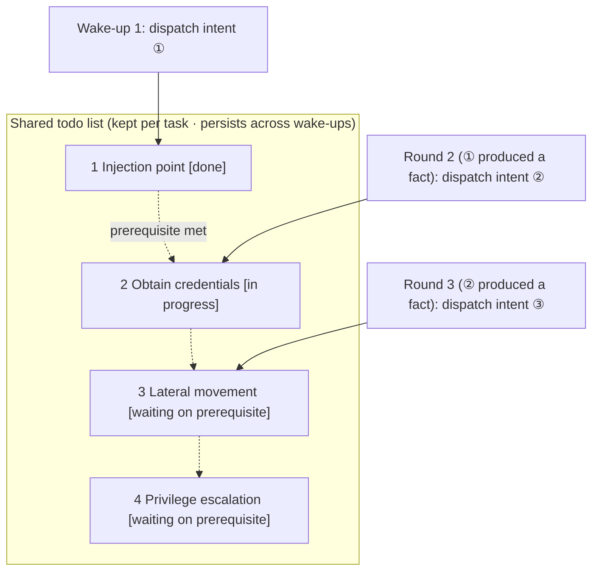

As a result, even with event-driven, stateless sessions, attack chains **progress steadily, without repeats and in the right order**. This is what lets ARTEX work through multi-step exploit chains on its own.

---

## Community

Scan the QR code to follow the **SecSentry** WeChat official account, then send it a direct message to join the discussion group.

<div align="center">


</div>

---
## References

https://github.com/oritera/Cairn


## Licence and disclaimer

### Open-source licence

This project is licensed under the **GNU Affero General Public License v3.0 (AGPL-3.0)**. See the [LICENSE](LICENSE) file in the repo root for the full terms.

This means anyone may freely use, modify and distribute this project, but **derivative works must also be open-sourced under AGPL-3.0**. In particular, **if you modify this project and offer it to users over a network (for example, deployed as an online service), you must also make the complete corresponding source code available to those users**.

> ⚠️ **Important**: the open-source licence itself does not restrict what the software is used for. The "Usage restrictions" and "Disclaimer" below are additional terms and a formal statement from the author to users. Please make sure you follow them.

**ARTEX is only for personal learning, code research and local technical validation. It must not be used to run actual tests against any live system or website.**

### Permitted use

- Only for **reading, learning from and researching this project's source code**, and for validating technical principles in a **local, isolated environment**;
- Suitable for non-offensive purposes such as personal learning, academic research and code review.

### Prohibited use

- **Using this tool to scan, probe, exploit or attack any website, online service or networked system is strictly prohibited** (whether or not you are authorised, and whether or not the assets are your own);
- Using this tool for any actual penetration testing, attack and defence exercises or in production environments is strictly prohibited;
- Using this tool for illegal intrusion, data theft, extortion, denial of service or any destructive or criminal activity is strictly prohibited;
- Using this tool for anything that breaks the laws and regulations of your country or region is strictly prohibited.

### Compliance responsibility

Users must comply with all laws and regulations on cybersecurity, data protection and computer crime in their country or region (in mainland China this includes, but is not limited to, the Cybersecurity Law, the Data Security Law, the Personal Information Protection Law and the related judicial interpretations). **Users bear sole responsibility for all legal liability and consequences arising from use of this tool.**

### Disclaimer

This project is provided "AS IS", without any warranty, express or implied. The authors and contributors accept no liability for any direct or indirect loss, data loss, system damage or legal dispute arising from use of this tool (whether or not it is used properly). **By downloading, installing or using this project, you confirm that you have read, understood and agreed to all of the above terms.**
