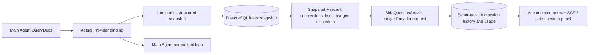

# ARTEX `/btw`

Regular chats, the task MainAgent and the current task's own Workers support independent side questions. Type `/btw question` in the main input box to submit one; an empty `/btw` or the "Side question" button opens the history. Desktop uses a resizable sidebar; mobile uses a Drawer.

Side answers are generated from the Agent context snapshot taken at submission time, and support streaming display, follow-up questions, stopping and clearing. Closing the panel, refreshing the page or disconnecting SSE does not cancel the model request. Stopping only affects the current side question; clearing cancels side questions and deletes the side question history, while keeping the main context snapshot.

## Implementation boundaries

Reuses Go, norma v0.3.7, Next.js and the existing Markdown / ResizablePanel / Drawer / AlertDialog components; norma's source was not modified and no dependencies were added for side questions. The Planner, Workers inherited from other tasks and upgrades to tool-type subtasks are out of scope for this change.

- `capture.go` only marks main loop requests in `Options.Deps.CallModel / CallModelSync`. The Provider decorator sits inside the concrete model, after the routing pool's outer selection, so it records the model actually selected; compaction and summary requests do not overwrite the snapshot.
- Snapshots are published at request start, on a complete model reply and at the run's terminal state. A half-generated reply is not published; tool calls stay paired via norma's `MessagesForAPI`, and tool results enter the snapshot at the next main model request or at the run's terminal state. An aborted stream keeps the previous valid boundary.
- Snapshots use a JSON deep copy to preserve structured messages, system prompts, tool definitions and generation parameters. Model inference holds neither the snapshot lock nor a database transaction.
- `SideQuestionService` calls the concrete Provider; when needed it first generates a side question summary, and the final answer may be retried once after reduction only when the first attempt exceeded the context limit and has not yet output any text/tool calls. It does not create an agent session, does not hook into the tool executor, main transcript, activity feed or task graph, and does not go through the task model switching chain. Answers keep the tool definitions for compatibility with the existing structured tool context; summary requests provide no tools. Newly returned tool calls have no execution path.
- One running request per parent session, at most four per service process, and a 120-second timeout per request. Side questions use an independent cancellation context under the service lifecycle.
- Side question requests keep a reference to the model config and a non-sensitive identity summary; credentials are taken from the existing config at request time. If the config is deleted, or identity fields such as model, protocol or address change, the main Agent must run first to update the snapshot. Tests do not change the product's default model.

## Persistence and recovery

`db/schema.sql` automatically creates `side_question_sessions` and `side_question_requests`. The former stores the parent resource, latest snapshot, run number, version and clear version; the latter stores the question, accumulated answer, status, model, snapshot time, usage, event sequence number and pagination ordinal.

The parent session key is the conversation ID, or task ID + exploration ID + intent ID. Workers do not use reusable execution slot names.

Snapshots are merged per parent session and flushed every 250 ms; the database compares `(run_id, version)` to stop an older version overwriting a newer one. The selected snapshot is saved again before a side question is submitted. After a successful save the large in-memory snapshot is released; on failure the pending version is kept. Accumulated answer content is written at most once every 250 ms as streaming events arrive; terminal states are saved immediately, with limited retries on database errors.

On service start, leftover `running` requests are marked `interrupted`, keeping any partial answer and usage already persisted; requests are not replayed automatically. The most recently saved context can be used directly for the next question. When an old session has no snapshot, the main Agent must run first; context is not rebuilt from UI activity records.

Clearing increments the clear version and deletes requests; conditional updates stop late callbacks from writing data back. Physical deletion of parent resources relies on foreign key cascades; logical deletion of a Worker deletes its side question data in the same transaction and rejects any late snapshots that arrive afterwards. Task archiving first blocks new requests, waits for the main flow to stop, then cancels side questions and waits for them to persist; the archive format is v3, and it stays compatible with v1/v2, which have no side question tables.

History is kept in full, and an ordinal cursor returns at most 20 entries per page. Model requests replay the raw text of at most the 20 most recent successful exchanges, while also limiting the replayed amount by a token budget; older exchanges are kept in a separate rolling summary. When the main context exceeds the budget, only the older part of the side question's copy is summarised, keeping recent structured tool calls and results. Summaries and preparation progress, together with their usage, all fall under the side question concurrency, cancellation and 120-second timeout limits. See [Context budget and open source references](CONTEXT_BUDGET.md) for details.

## HTTP contract

The following paths serve as `{parent}`, reusing the existing authentication and resource checks:

- `/api/conversations/{id}`
- `/api/tasks/{id}/chat`
- `/api/tasks/{id}/intents/{iid}`

| Request | Response and behaviour |
| --- | --- |
| `GET {parent}/side-questions?before={ordinal}` | `items` ordered newest to oldest, a separate `current` run status, `snapshot` metadata and `next_cursor`; a cursor of 0 means the latest page / no next page |
| `POST {parent}/side-questions` | JSON `{ "question": "…", "client_request_id": "UUID" }`; a new request returns 202 and the request object; the same ID and question return the existing object with 200 |
| `DELETE {parent}/side-questions` | Cancels and clears the side questions of the current parent session |
| `GET /api/side-questions/{requestID}/events` | `snapshot` SSE events, where `id` is an increasing sequence number and `data` is the full accumulated request object; sends `cleared` on clear |
| `POST /api/side-questions/{requestID}/cancel` | Explicit cancellation; the terminal state can be read from the history or SSE |

Questions are limited to 4000 characters. No snapshot, a model config change, a busy parent session or an idempotency ID conflict returns 409; hitting the global concurrency limit returns 429. Every SSE connection sends the accumulated state first, without relying on text fragments the client received earlier. The frontend merges by request ID + sequence number, and discards old callbacks when switching parent session or clearing.

## Validation and references

See [VALIDATION.md](VALIDATION.md) for automated checks, real model usage and known limitations.

Independent requests follow [Grok CLI side-question.ts (pinned commit)](https://github.com/superagent-ai/grok-cli/blob/fb97af83f06dca873281d60168430f06c8de6324/src/utils/side-question.ts), and run isolation follows [OpenCode (pinned commit)](https://github.com/anomalyco/opencode/tree/b3f1a96c6dd7adeb28b36dd11add1998fc84d67b). ARTEX's context uses norma's structured messages rather than stitching text together from frontend logs.
